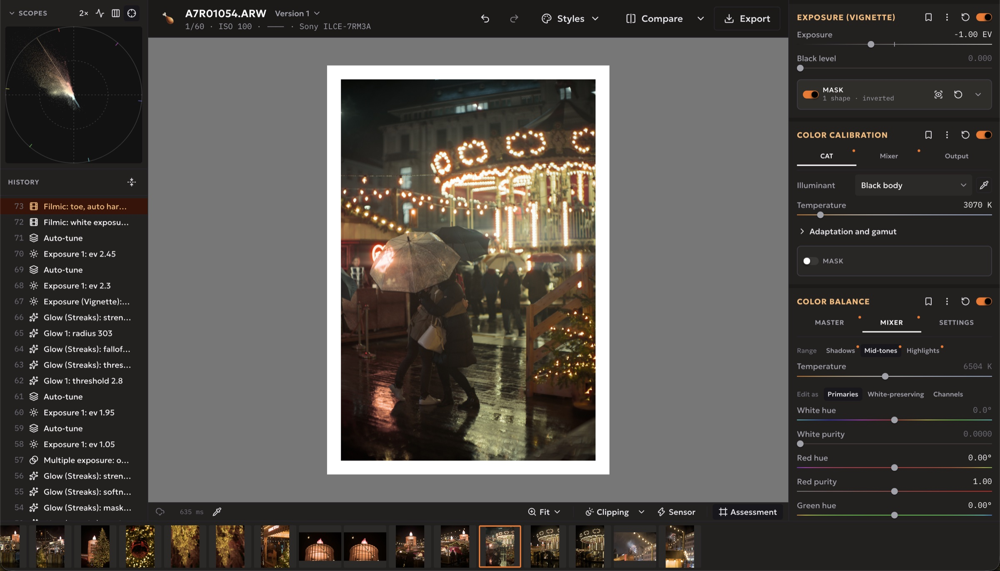

# 🍗 RAWtisserie

**From raw to well done.**

RAWtisserie is a photo library and RAW developer that runs in your browser, inspired by
[Ansel](https://ansel.photos) and [darktable](https://www.darktable.org).



- **Library**: import RAW files and images, then filter, rate, tag and cull them. Originals
  are never modified.
- **Developer**: a scene-referred pipeline with ports of Ansel's modules (filmic, colour
  calibration, colour balance, diffuse or sharpen…), masks, retouching, presets and styles,
  and export to JPEG, PNG or TIFF.
- **In the browser**: the pixel pipeline is Rust compiled to WebAssembly. The server runs
  the same module to render previews. `/develop` works without an account, and nothing
  is uploaded.

More in [the feature list](docs/guide/features.md) and the
[keyboard shortcuts](docs/guide/keyboard-shortcuts.md).

## Getting started

Prerequisites: Node ≥ 24, Rust (stable) with the `wasm32-unknown-unknown` target,
`wasm-bindgen-cli` **0.2.129** (it must match the crate version), and podman or docker.

```sh
rustup target add wasm32-unknown-unknown
cargo install wasm-bindgen-cli --version 0.2.129 --locked

cp .env.example .env
npm install
npm run db:up        # Postgres on localhost:5433 (podman/docker)
npm run dev          # builds the wasm, then runs the API (:4000) and Vite (:5173)
```

Open http://localhost:5173 and create an account. Migrations run automatically on
server start; `npm run db:migrate` runs them by hand.

### Useful commands

| Command                                                                      | What it does                                                |
| ---------------------------------------------------------------------------- | ----------------------------------------------------------- |
| `npm run build:wasm`                                                         | Rebuild the WebAssembly pipeline (`packages/pipeline/wasm`) |
| `npm run build`                                                              | wasm + production web build (served by the API server)      |
| `npm test`                                                                   | Rust tests + TS tests                                       |
| `npm run typecheck`                                                          | TypeScript in every workspace                               |
| `npm run format`                                                             | Prettier on everything (CI runs `npm run format:check`)     |
| `npm run db:schema -w @rawtisserie/server`                                   | Regenerate DB types into `apps/server/src/__generated__`    |
| `cargo run --release --example develop -- in.ARW out.jpg 2048 [params.json]` | Develop a file from the CLI                                 |

The golden-image tests need `./scripts/fetch-golden-raws.sh` once; see
[Tests](docs/ARCHITECTURE.md#tests).

### Production

`npm run build && npm run start -w @rawtisserie/server` serves both the API and the
built web app from port 4000. Set `COOKIE_SECURE=true` behind HTTPS, and
leave `ALLOW_SIGNUP` unset so that sign-up needs an invitation (admins manage them, and
users' storage quotas, at `/admin`; see [docs/DEPLOYMENT.md](docs/DEPLOYMENT.md) for the
first admin). Originals, renders and LUTs are stored
under `STORAGE_DIR`, or in an S3-compatible bucket when `S3_BUCKET` is set.
[docs/DEPLOYMENT.md](docs/DEPLOYMENT.md) has the deployment diagram and what CI checks.

## Documentation

- [Architecture](docs/ARCHITECTURE.md): the code layout, the pixel pipeline and its caches, tests
- [Image modules](docs/MODULES.md): what each module ports from Ansel and darktable, and how it deviates
- [Roadmap](docs/ROADMAP.md), [performance notes](docs/PERFORMANCE.md), [deployment](docs/DEPLOYMENT.md)

## Credits

RAWtisserie would not exist without the work of Aurélien Pierre on
[darktable](https://www.darktable.org) and [Ansel](https://ansel.photos): its
scene-referred approach and most of its image modules come from there.

The filmic, colour calibration, colour primaries, contrast equalizer and retouch modules are
ports of [Ansel](https://ansel.photos)'s `filmicrgb`, `channelmixerrgb`, `colorprimaries`,
`atrous` and `retouch`/`heal` by Aurélien Pierre and contributors, licensed GPL-3.0-or-later. Lens correction from
embedded data follows darktable's `lens.cc` (GPL-3.0-or-later). Lens correction profiles
come from the [lensfun](https://lensfun.github.io) database (CC BY-SA 3.0,
`packages/pipeline/lensfun/`, built by `scripts/lensfun-db.mjs`), searched and
interpolated as lensfun's library does. RAW decoding uses
[rawler](https://github.com/dnglab/dnglab) (LGPL-2.1). The test RAWs come from
[raw.pixls.us](https://raw.pixls.us) (CC0).

## License

RAWtisserie is licensed under the [GNU Affero General Public License v3.0 or
later](LICENSE) (AGPL-3.0-or-later). If you run a modified version as a network
service, you must offer its source to the users of that service. The Ansel- and
darktable-derived modules keep their GPL-3.0-or-later terms, which allow combining
them with AGPL-3.0 code (GPLv3 §13).
